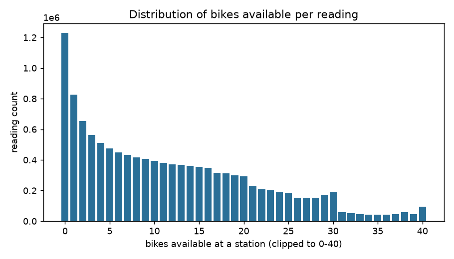
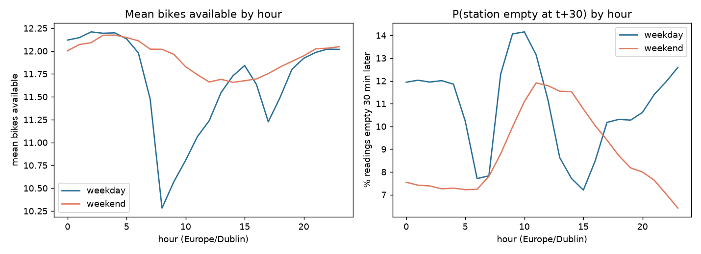
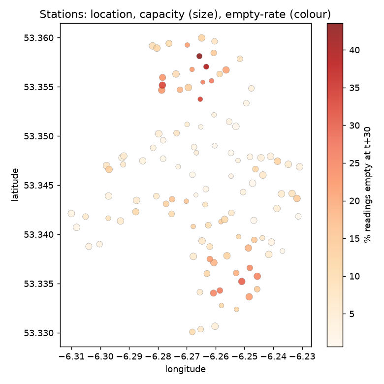
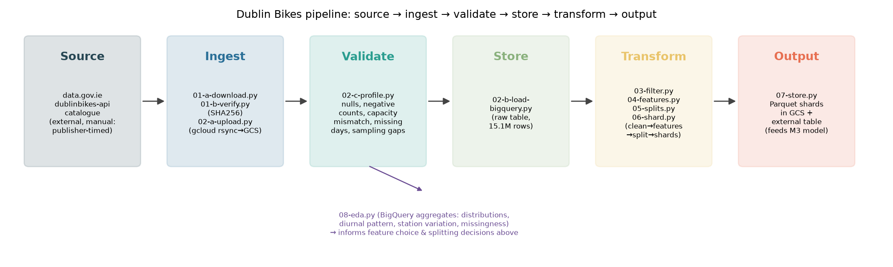

# Milestone 2 — Data Understanding and Pipeline Setup

Repository: https://github.com/Danny-cert-AI/project.

## Updates to Milestone 1 based on feedback

1. `requirements.txt` was missing some dependencies and unpinned. Dependencies are now pinned with a full
   `requirements.lock` (commit `85babfb`).
2. Feedback suggested an ID-based or view-based BigQuery design instead of separate large tables as these
   duplicate data. The pipeline already follows this: `station_status_clean`, `_features` and `_split` are
   each built from the table before it with `CREATE OR REPLACE TABLE ... AS SELECT`, and all four tables
   share the same `station_id` key rather than denormalising station metadata into every row.
3. Raw CSVs are now gzipped, which resulted in a 92% size reduction confirmed with `gzip -l`. BigQuery
   loads gzipped CSVs directly, so `02-b-load-bigquery.py` needs no change.
4. Attribution in MILESTONE1.md was corrected.

## Project definition

**Title**: Dublin Bikes — station availability prediction.

**Problem statement**: for a given Dublin Bikes station at a given time, predict the number of bikes
available 30 minutes ahead, and whether the station will be empty (zero bikes) at that point.

**Intended users/setting**: a customer deciding whether to walk to a station, or the Dublin Bikes operator
deciding which stations need bikes moved before they run out.

**Change from Milestone 1**: Milestone 1 only profiled raw-table quality; this milestone adds exploratory
data analysis.

## Data source

- **Source**: [data.gov.ie — Dublin Bikes API](https://data.gov.ie/dataset/dublinbikes-api), historical
  snapshots published by the National Transport Authority Dublin Bikes scheme.
- **Licence**: data.gov.ie publishes this resource under the Creative Commons Attribution 4.0 licence
  (CC-BY 4.0), permitting reuse with attribution.
- **Collection context**: each file is a roughly 5-minute snapshot of every station's bike count and status
  flags, scraped from the public Dublin Bikes station-status API and archived monthly.
- **Permissions**: public open data, downloaded via `01-a-download.py` against the public catalogue API.
- **Privacy**: no GDPR data. Records consist of how many bikes/docks are at a station at a point in time.
- **Bias/limitations**: Snapshot timing is not regular and there are periods of the source data with no
  coverage at all (3 gaps totalling 39 days), which is a limitation of the published data, not of this
  pipeline.

## Data description

- **Unit of analysis**: one row = one station's reading at one timestamp (station_id × last_reported).
- **Records**: 15,149,940 raw rows, after cleaning 12,112,109.

  | Split | Rows | Share |
  |---|---|---|
  | Train | 9,330,011 | 77% |
  | Validate | 1,260,240 | 10% |
  | Test | 1,521,858 | 13% |

- **Target variable**: `empty_t_plus_30` (classification) / `bikes_t_plus_30` (regression), both derived
  from the station's own reading exactly 30 minutes later.
- **Time range**: 02/05/24 to 30/06/26 across train/validate/test.
- **Known limitations**: 39 days with no readings at all (27 in September 2024, 1 in July 2025, 11 in
  January/February 2026).

5.05% of raw rows dropped for a bikes+docks/capacity mismatch.

## Exploratory data analysis

**Code**: [`src/08-eda.py`](src/08-eda.py) — new for Milestone 2. It runs all aggregation in BigQuery
(the feature table is 12.1M rows) and only pulls small aggregated results into pandas for plotting, the
same approach as the existing profiling script. Output log: `logs/08-eda.log`.

### Distribution of bikes available



Readings are right-skewed with a sharp spike at zero: 0 bikes is the single most common reading (1.23M of
12.1M rows, ~10%), and the 95th percentile is 30 bikes against a median of 10 and a maximum station capacity
of 40.

### Diurnal pattern — the main EDA finding



Weekday availability has a sharp commuter signature: mean bikes available at a station falls from ~12.2 at
07:00 to a trough of 10.3 at 08:00 (riders taking bikes out for the morning commute), partially recovers
through the day, dips again around 17:00 (evening commute), and climbs back overnight. Weekend availability
is much flatter.

### Station-level variation



Empty-rate at t+30 varies enormously by station: from 0.7% to 43.5% across the 115 stations. The three
worst stations (IDs 79, 61, 30; 39–44% empty-rate) cluster geographically in the north-east of the network
near the city centre/north docks area, the small cluster of dark points in the plot.

## Design / Architecture



| Stage | Script(s) |
|---|---|
| Source | data.gov.ie dublinbikes-api catalogue |
| Ingest | `01-a-download.py`, `01-b-verify.py`, `02-a-upload.py` |
| Validate | `02-c-profile.py` |
| Store | `02-b-load-bigquery.py` (raw), `07-store.py` (Parquet + external table) |
| Transform | `03-filter.py`, `04-features.py`, `05-splits.py`, `06-shard.py` |
| Output | `07-store.py` Parquet shards in `gs://setu-dhi-03-dublinbikes-raw/processed/` + `station_status_processed` external table |
| EDA | `08-eda.py` (new) |

Manual, one-time setup only: creating the GCP project/bucket/BigQuery dataset, and exporting
`GOOGLE_APPLICATION_CREDENTIALS` before running any script that talks to GCP (both documented in the
README). Nothing in the per-run path requires a manual step.

## Implementation

All scripts below ran successfully against the full dataset (not a sample) in this milestone; output logs
are committed under `logs/` for every stage. Re-running `08-eda.py` end-to-end:

```sh
$ export GOOGLE_APPLICATION_CREDENTIALS=~/.config/setu-gcp/setu-dhi-03-admin.json
$ ./src/08-eda.py
2026-11-04 23:13:35 INFO quantiles: {'bikes_min': 0.0, 'bikes_p50': 10.0, 'bikes_p95': 30.0, 'bikes_max': 40.0, ...}
2026-11-04 23:13:37 INFO saved bikes_available_hist.png
2026-11-04 23:13:38 INFO saved target_by_hour.png
2026-11-04 23:13:38 INFO weekday peak empty rate 14.2% at hour 10
2026-11-04 23:13:40 INFO saved station_map.png
2026-11-04 23:13:40 INFO 115 stations, empty-rate range 0.7%-43.5%
2026-11-04 23:13:42 INFO target balance per split (cross-check against MILESTONE1.md splits table): [...]
2026-11-04 23:13:42 INFO done; plots in images/eda
```

**Milestone 3 plan**: train the baseline on the `train` shard, tune on `validate`, keep `test` untouched
until final report.

**Attribution**: I used AI (Claude) to draft the EDA and generate the arch diagram and plots. I ran every
script myself, read the logs and plots it produced, and the interpretation of what they show and the
resulting pipeline/report decisions in this document are my own.
